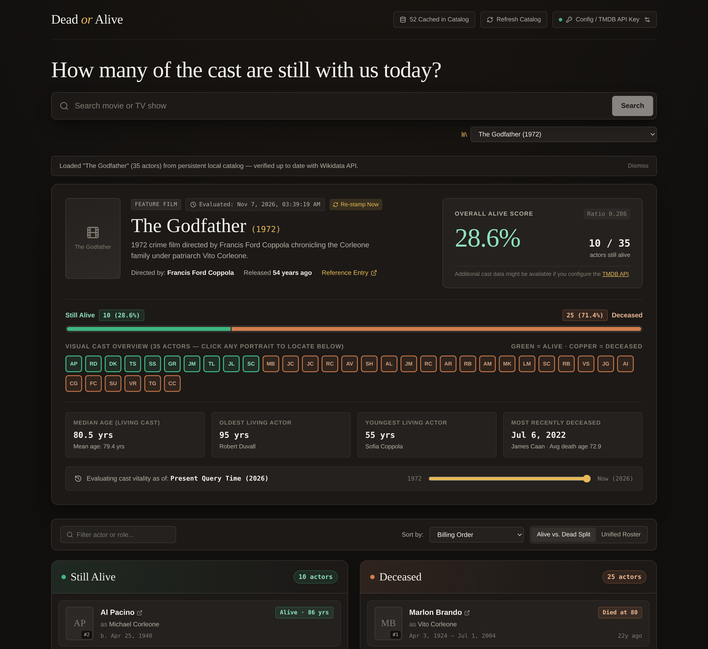
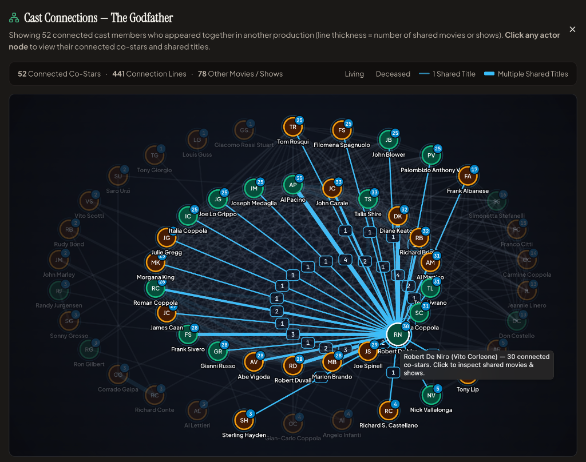
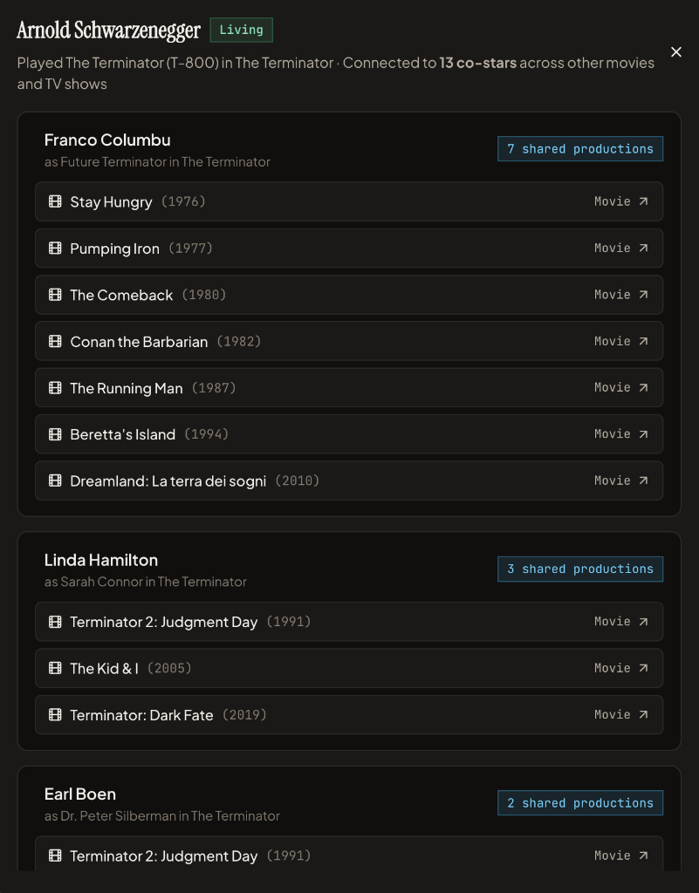

# Dead or Alive

<p align="center">
  
</p>
<p align="center">
  
  &nbsp;&nbsp;
  
</p>

**Dead or Alive** is a responsive web application built with **Vite + React + TypeScript** that lets you search for any movie or television series and determines how many of its credited cast members are still alive at the exact moment your query is evaluated.

**Live Application:** [https://ferschke.github.io/dead-or-alive/](https://ferschke.github.io/dead-or-alive/)

---

## Key Features

- **Real-Time Vitality Evaluation**: Accessing any movie or TV show refreshes its data against the configured APIs and evaluates each actor's living status, current age, or age at passing at that exact timestamp.
- **Alive Score & Cast Demographics**: Displays the proportion of living cast members as a percentage, fraction, and decimal ratio alongside a visual split bar and key stats (median/mean living age, oldest and youngest living actors, and most recently deceased).
- **Interactive Cast Matrix & Roster**:
  - **Cast Vitality Matrix**: A color-coded grid of actor portraits/initials (green for living, copper for deceased) that scrolls to and highlights the selected actor below.
  - **Split & Unified Views**: Browse actors in side-by-side **Still Alive** and **Deceased** columns or a single unified list, with instant search filtering by actor or role and sorting by billing order, age, name, or date of passing.
- **Cast Connections Network**: Maps how cast members of the selected movie or TV show are connected through other productions they appeared in together. Opening the network dialog renders an interactive graph where all cast members appear as nodes and any pair of co-stars with shared external credits is joined by a single line scaled in thickness by the number of shared movies or shows. Clicking any actor node opens a detail dialog listing their connected co-stars and shared titles, each linking directly back to load that movie or show in the app.
- **Persistent Local Catalog & Background Sync**: Pre-loaded with a starter catalog and backed by browser `localStorage` so newly searched titles persist across sessions. Cached entries load immediately and automatically sync with the APIs in the background, or you can update all cached titles at once via **Refresh Catalog**.
- **Wikidata & Optional TMDB Integration**: Works out of the box with public **Wikidata**, **Wikipedia**, and **TVMaze** APIs with no setup required. You can optionally add a free [TMDB API Key](https://developer.themoviedb.org/docs/getting-started) in the settings dialog to enrich titles with more complete movie and TV cast lists, character roles, posters, and biographical dates.
- **Responsive Layout**: Designed for desktop browsers with a responsive layout that adapts cleanly to iPhone and Android screens.

---

## Development

```bash
npm install
npm run dev
```

## Production Build

```bash
npm run build
npm run preview
```
